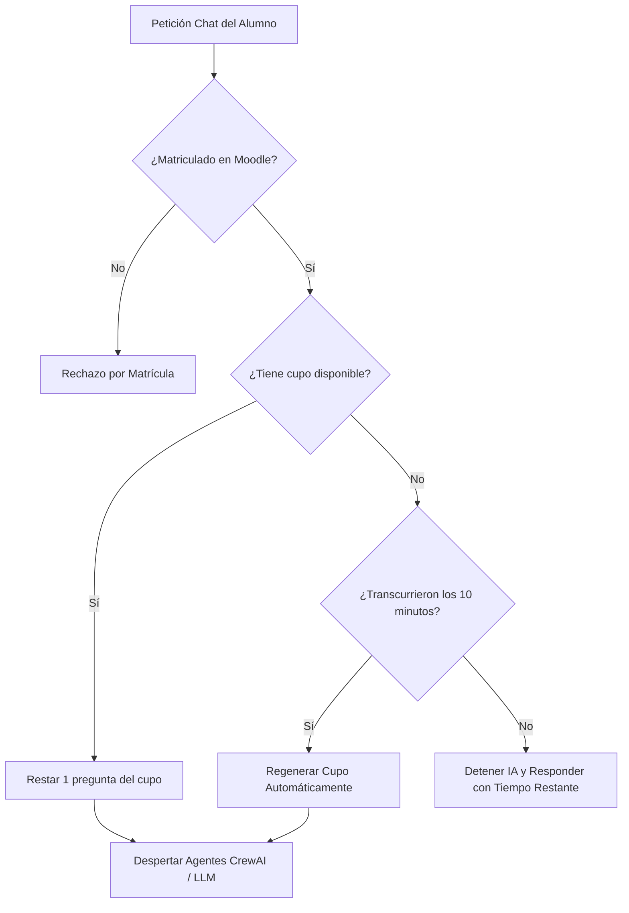

# Módulo de Sistema de Ahorro de Tokens y Autorregeneración

- **Responsable**: Backend 1 (ESTEBAN)
- **Fecha**: 18/10/2026
- **Rama**: `Esteban`
- **Archivos afectados**:
  - [`skills/control_tokens.py`](../skills/control_tokens.py) *(Nuevo)*
  - [`config.json`](../config.json)
  - [`bot_crewai.py`](../bot_crewai.py)
  - [`server.py`](../server.py)
  - [`tests/test_control_tokens.py`](../tests/test_control_tokens.py) *(Nuevo)*
- **Estado**: ✅ Implementado y Verificado (4/4 pruebas específicas y 23/23 pruebas globales aprobadas)

---

## 🎯 Objetivo de la Tarea

Prevenir el uso ilimitado de la IA por parte de los estudiantes en Moodle, protegiendo las cuotas de tokens de Groq / LiteLLM mediante:
1. **Límite de Consultas**: Restringir el número de preguntas que un alumno puede realizar por ventana de tiempo.
2. **Detención e Información**: Cuando un alumno alcanza el límite, la IA no se ejecuta (0 tokens consumidos) y notifica el por qué y el tiempo restante exacto para volver a consultar.
3. **Autorregeneración Automática**: El cupo se regenera automáticamente una vez transcurrido el tiempo anunciado.

---

## ⚙️ Parámetros y Límites Estándar Configurados

De acuerdo a las mejores prácticas de la industria y estándares de modelos LLM:

| Parámetro | Valor Exacto | Descripción |
| :--- | :---: | :--- |
| **`max_tokens_entrada`** | **4096 tokens** | Límite estándar de ventana de contexto en entrada (Prompt Context Window). |
| **`max_tokens_salida`** | **1024 tokens** | Límite estándar de tokens en salida por respuesta (Completion Tokens) configurado en `LLM(..., max_tokens=1024)`. |
| **`max_preguntas`** | **5 preguntas** | Cantidad de preguntas permitidas por alumno antes de pausar temporalmente el servicio. |
| **`ventana_minutos`** | **10 minutos** | Tiempo exacto tras el cual los tokens se autorregeneran al 100% de manera automática. |

*Nota: Los valores son totalmente ajustables en `config.json` o mediante variables de entorno (`MAX_PREGUNTAS_USUARIO`, `TIEMPO_REGENERACION_MINUTOS`). El usuario Administrador (`user_id == 2`) no tiene restricciones.*

---

## 🔄 Funcionamiento del Algoritmo



### Mensaje Notificado al Alumno:
> *"⏳ Límite de consultas alcanzado: Has agotado tu cupo de 5 preguntas disponibles para cuidar los recursos y tokens del sistema. Tus tokens se autorregenerarán automáticamente en Xm Ys (podrás volver a consultar a partir de las HH:MM:SS)."*

---

## 🧪 Pruebas Automatizadas

Se incorporó la suite [`tests/test_control_tokens.py`](../tests/test_control_tokens.py):
```bash
python -m unittest tests/test_control_tokens.py -v
```

- ✅ `test_consumo_gradual_hasta_limite`: Comprueba el descuento gradual hasta detener la IA en la pregunta 4.
- ✅ `test_admin_sin_limite`: Comprueba que el Administrador (ID 2) no sea bloqueado.
- ✅ `test_autoregeneracion_automatica_por_tiempo`: Verifica que al vencer los 10 minutos la cuota se recarga sola.
- ✅ `test_server_endpoint_bloquea_y_no_llama_agentes`: Valida que el servidor detenga la petición sin llamar a CrewAI.
